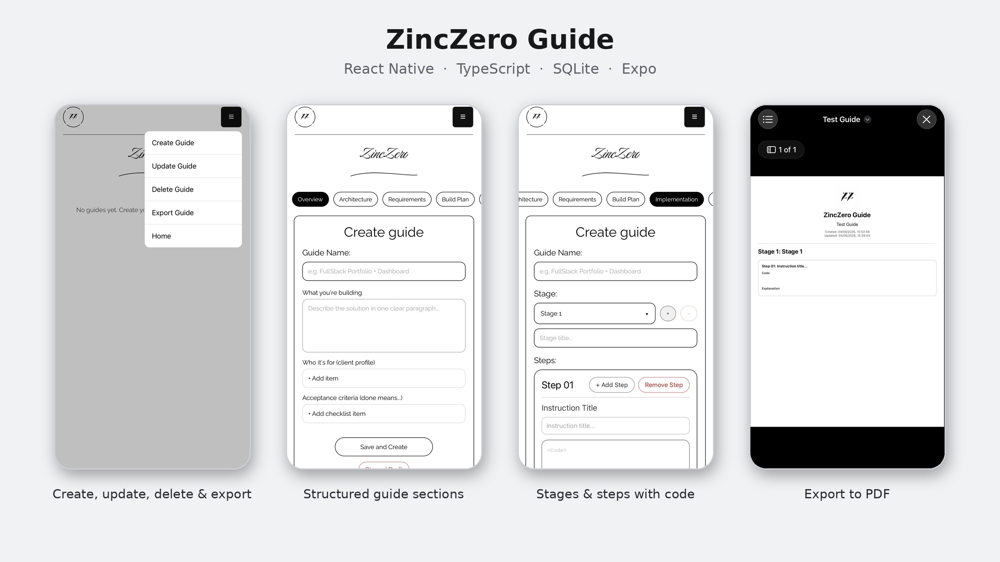

# ZincZero Guide

A cross-platform mobile app for creating, following and exporting structured technical guides. Each guide is organised into sections (overview, architecture, requirements, build plan, implementation, security, database, testing, deployment and hand-off) and broken down into stages and steps with code, explanations and images.



## Tech stack

- React Native 0.81 with Expo SDK 54
- TypeScript
- SQLite (`expo-sqlite`) for offline storage
- React Navigation
- Expo SecureStore and Crypto for local authentication
- Expo Print, File System and Sharing for exports
- EAS Build configuration for iOS and Android

## Features

- Create, update and delete guides through a tabbed, multi-section editor
- Stages and steps with instruction titles, code blocks, explanations, images and attachments
- Progress tracking: steps can be marked complete, and guides have active, completed or cancelled status
- Export guides to PDF, Markdown or JSON, and share them from the device
- Local login with salted password hashing and a session kept in secure storage
- Fully offline: all data is stored on the device

## Data model

A relational SQLite schema with foreign keys and cascading deletes:

- `guides` → `stages` → `steps`
- `guide_sections`: per-section JSON content, unique per guide
- `users`: username, salted password hash

Lightweight in-app migrations add new columns to existing databases when the app updates.

## Running locally

```bash
npm install
npx expo start
```

Then open the app in Expo Go or a development build on iOS or Android.

**Demo login:** on first launch the app creates a local `admin` account with the password `admin123`, for demonstration only. Change or remove it before using the app for anything real.
